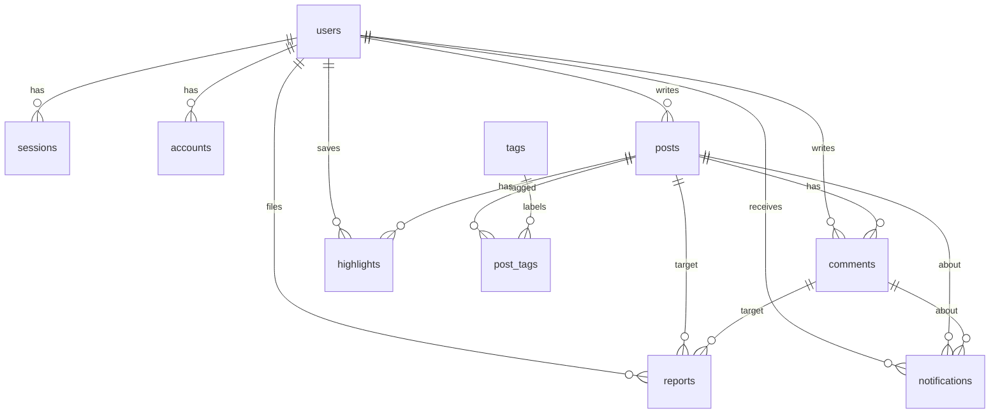

# ERD / 데이터베이스

마이그레이션: `drizzle/0000_extensions.sql`(pg_trgm), `0001_init.sql`, `0002_single_reaction.sql`, `0003_remove_reactions.sql`(반응 기능 제거). 스키마 원본: `src/lib/db/schema.ts`.

## 테이블

| 테이블 | 주요 컬럼 | 제약/인덱스 |
|---|---|---|
| `users` | id(text), display_name, email(unique), avatar_url, role(user/admin), banned, ban_reason, ban_expires, email_verified, created_at, updated_at | display_name trigram GIN |
| `sessions` / `accounts` / `verifications` | Better Auth 관리 (accounts.password 에 해시 저장) | user_id FK cascade |
| `posts` | id(uuid), author_id, title, content(Markdown), content_text, excerpt, source_format(docx/markdown), source_file_path(null: 원본 미보관), visibility(public/private), status(draft/published/hidden), created_at, updated_at, published_at | title 1~200자 CHECK, 공개 피드 부분 인덱스, (author_id, created_at), title trigram GIN |
| `tags` | id, name, slug(unique), created_at | |
| `post_tags` | post_id, tag_id | PK(post_id, tag_id), tag_id 인덱스 |
| `comments` | id, post_id, author_id, content, created_at, updated_at | 1~3000자 CHECK, (post_id, created_at), (author_id, created_at) |
| `highlights` | id, user_id, post_id, selected_text, start_offset, end_offset, context_before, context_after, created_at | **UNIQUE(user_id, post_id, start_offset, end_offset)**, 범위/길이 CHECK, (user_id, created_at) |
| `notifications` | id, recipient_id, actor_id, type(comment), post_id, comment_id, is_read, created_at | (recipient_id, is_read, created_at) |
| `reports` | id, reporter_id, target_type(post/comment), post_id, comment_id, reason, status(open/resolved/dismissed), resolved_by, resolved_at, created_at | 중복 신고 UNIQUE(reporter, post, coalesce(comment)), 대상 일관성 CHECK |

## 명세와의 차이

- `users.status` 대신 Better Auth admin 플러그인의 `banned`(+사유/만료)를 사용한다. `name`/`image` 필드는 DB 컬럼 `display_name`/`avatar_url` 로 매핑했다.
- `posts.status` 의 "삭제"는 상태값 대신 실제 삭제(hard delete)로 처리한다. 관리자 비노출은 `hidden`.
- `posts.content_text`, `posts.excerpt` 추가 (검색 미리보기·하이라이트 검증용).
- `reports` 테이블 추가 (P1 신고 기능).

## 삭제 정책

- 글 삭제 → 태그 연결, 댓글, 하이라이트, 알림, 신고가 `ON DELETE CASCADE` 로 함께 삭제
- 사용자 삭제 → 해당 사용자의 모든 데이터 cascade (UI 에는 정지만 노출, 삭제는 DB 작업)
- 신고 처리자 삭제 → `resolved_by` SET NULL

## 권한 (RLS 대신 애플리케이션 계층)

Supabase 를 쓰지 않으므로 RLS 는 적용하지 않았다. 앱은 단일 DB 역할로 접속하며, 모든 접근은 `features/*/service.ts` 를 거치고 권한 검증이 통합 테스트(`tests/integration`)로 확인된다. 다른 경로(외부 BI 도구 등)로 DB 에 접속하게 되면 RLS 도입을 검토해야 한다 (decisions.md D-01).
